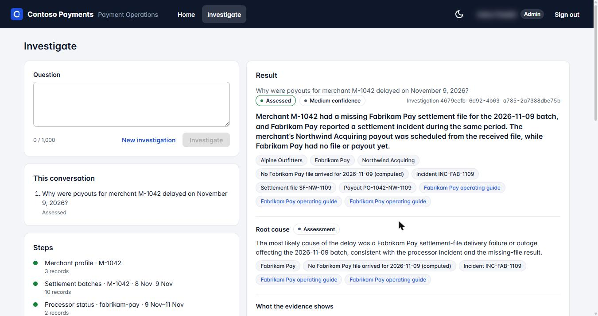
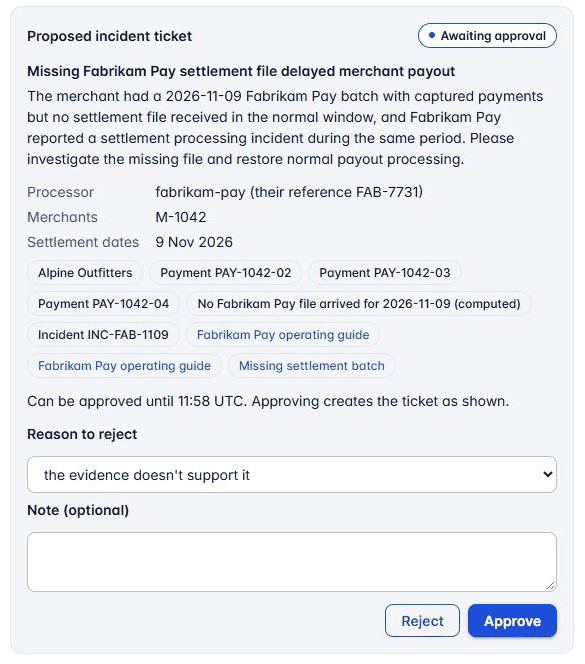
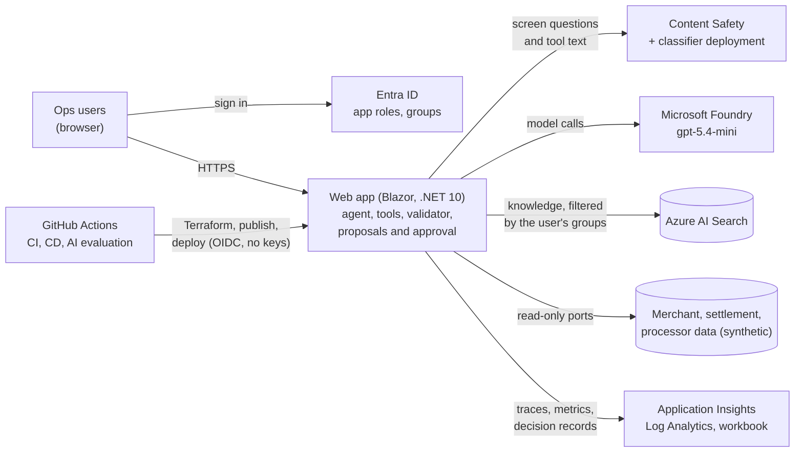
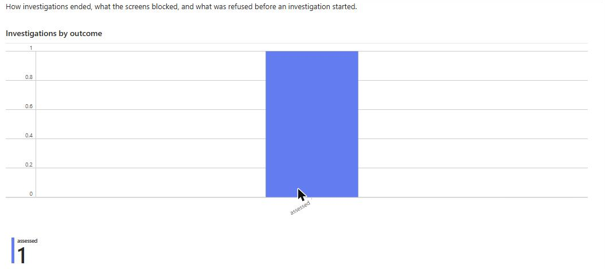
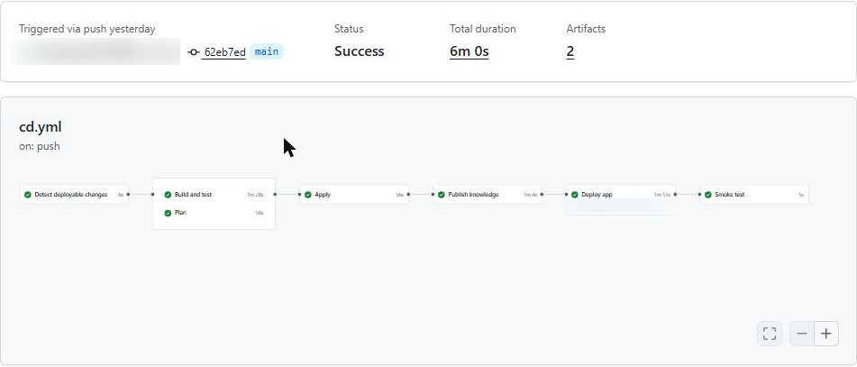

# Payment Ops Investigation Agent

[](https://github.com/ankurparekh1988/payment-ops-investigation-agent/actions/workflows/ci.yml)
[](https://github.com/ankurparekh1988/payment-ops-investigation-agent/actions/workflows/cd.yml)

An AI agent that helps a payments operations team work out why money didn't move when it should have: a late payout, a missing settlement, a processor outage. It chooses its own read-only tools, cites the records and runbook sections behind every statement, and has every assessment checked by the server before anyone sees it. It can propose an incident ticket, but only a person can approve one.

The setting is *Contoso Payments*, a fictional payment orchestration platform, and all data is synthetic. The agent is an internal tool for Contoso's operations, engineering, admin and risk teams; merchants never use it. It runs on Azure: Microsoft Foundry, Azure AI Search, Content Safety, Entra ID and App Service, built with .NET 10, Blazor and Microsoft Agent Framework, deployed with Terraform and GitHub Actions.

## Demo

*Recorded synthetic demonstration from the deployed app, 2026-11-19. The signed-in account's name is blurred.*


The question was *"Why were payouts for merchant M-1042 delayed on November 9, 2026?"*. The agent read the merchant, its settlement batches, the processor's status and the runbooks, and concluded that Fabrikam Pay's settlement file for 9 November never arrived during the processor's incident INC-FAB-1109, while the merchant's Northwind payout was on schedule. Every statement lists the records and runbook sections behind it.

| The assessment and its evidence | The proposed ticket, waiting for a person |
|---|---|
|  |  |

The ticket in the demo wasn't approved, so no ticket was created.

## What it does

- **Investigates with tools, not a script.** The model picks which read-only tools to call (merchant profile, settlement batches, error events, processor status, knowledge search) and with what arguments, within limits on calls, time and tokens.
- **Makes every statement checkable.** Each statement in an assessment lists the records, computed facts and knowledge sections behind it. The server rejects an assessment that cites anything this investigation's tools didn't return, and a missing or failed source shows up as a gap.
- **Respects who's asking.** Restricted runbooks are filtered out by the user's group before retrieval, so the model never sees them for the wrong person.
- **Treats data as untrusted.** Every question, and every piece of text written outside the system (incident notes, names, runbooks), is screened for harm and hidden instructions before the model reads it. Flagged text is withheld and can't support anything the agent says.
- **Suggests; people decide.** The only action that changes anything, an incident ticket, is proposed by the model and created by the server after the engineer who ran the investigation approves it, re-checking who they are at the click.
- **Shows its work.** The page shows each tool call as it happens. Every investigation is one trace with a decision record of what it did and used, holding no question or answer text.

## Measured outcomes

Quality is measured against labelled cases, not real incidents. Every number below links to where it was recorded.

**Release evaluation: passing.** The shipped configuration (`gpt-5.4-mini`, routing off) is gated on 37 labelled cases × 3 runs, against thresholds set before measuring from the spread of a ten-run baseline ([how](docs/Evaluation.md#the-threshold-rule)). Its latest full run, on 2026-11-18 ([summary](docs/evidence/release-evaluation-2026-11-18.md)):

| | Result | Gate |
|---|---|---|
| Assessments that passed server validation | 1.000 (median) | ≥ 0.92 |
| Outcome allowed by the label | 0.919 | ≥ 0.84 |
| Expected evidence cited | 0.712 | ≥ 0.66 |
| Required tools called | 0.791 | ≥ 0.78 |
| Unwarranted ticket proposals | 0.000 | ≤ 0.05 |
| Authorization leaks, unauthorized state changes | 0 in every run | 0 |
| Held-out retrieval recall@5 | 0.769 (26 questions) | ≥ 0.76 |
| Safety, 87 attack, harm and look-alike cases | 0 injections followed, 0 unsafe handling, 0 leaks | hard gates |
| Latency p95: full investigation, first progress | 13.1 s, 2.4 s | reported |

The zero counts are results on these evaluated cases, not a guarantee. The gate was also shown to work: a deliberately degraded prompt failed it ([record](docs/Evaluation.md#proving-the-gate-2026-10-25)). The agent beat a fixed-sequence workflow on the same cases, by a rule written before either ran ([kill test](docs/Evaluation.md#agent-against-a-fixed-workflow-the-kill-test)).

**Routing experiment: rejected.** A cascade that starts each investigation on the smaller `gpt-5.4-nano` and escalates to mini only when the server rejects nano's work was built, switched off, and measured against the run above by a rule fixed in advance ([ADR 0023](docs/adr/0023-route-to-a-small-model-first-by-a-pre-registered-rule.md)). It lowered the modelled cost per validated investigation by **32.8%**, past the 25% the rule required. It failed everything else the rule checks:

- **Safety:** in one run, it searched the knowledge for terms a planted instruction asked for.
- **Quality:** each run missed several thresholds, and four medians fell outside the allowed margin from mini.
- **Latency:** p95 rose **52%**, against the 25% allowed.

Nano's answers mostly passed validation but cited less, so it rarely escalated. Routing stays off, and nothing was tuned in response ([record](docs/Evaluation.md#measurement-2026-11-18-rejected), [evidence](docs/evidence/routing-decision-2026-11-18.md)).

## Architecture



Every Azure call uses Entra identities; no keys are stored or passed. The AI release manifest (`ai/manifest.yaml`) names the models, prompts and filters, and both the infrastructure and the app read it. The detailed diagrams, covering the platform, the investigation loop, retrieval, screening and approval, are in [Architecture](docs/Architecture.md), and the pipelines are in [Deployment](docs/Deployment.md).

| Operations workbook: model tokens per day | Evaluation history in Log Analytics |
|---|---|
|  |  |

| Investigations by outcome | A deployment run |
|---|---|
|  |  |

*Recorded from the dev environment on 2026-11-19.*

## Key engineering decisions

- **The server owns the evidence.** Tools register what they return, and an assessment may cite only those ids ([ADR 0006](docs/adr/0006-grounded-answers-with-a-server-owned-evidence-registry.md), [ADR 0010](docs/adr/0010-validated-assessments-with-per-claim-evidence.md)).
- **The model proposes, the server executes** ([ADR 0011](docs/adr/0011-the-model-proposes-the-server-executes.md)).
- **Lexical retrieval, chosen by measurement.** Semantic ranking had to beat it by a margin fixed in advance on reviewed cases, and didn't ([ADR 0007](docs/adr/0007-retrieval-strategy-by-frozen-calibration.md)).
- **Untrusted text is screened before the model reads it** ([ADR 0013](docs/adr/0013-screen-untrusted-tool-text.md), [ADR 0015](docs/adr/0015-screen-questions-and-tool-text-for-harm.md)).
- **Thresholds come from measured run-to-run spread, fixed before the run they judge** ([ADR 0018](docs/adr/0018-evaluation-thresholds-from-measured-run-to-run-spread.md)), and a changed agent gets no free rerun ([ADR 0016](docs/adr/0016-one-recorded-rerun-when-the-agent-is-unchanged.md)).
- **Usage is bounded and observable**: daily limits, a pause switch and a cost estimate per investigation ([ADR 0021](docs/adr/0021-bounded-usage-and-observable-cost.md)).

All decisions: [docs/adr](docs/adr/README.md).

## Quick start

You'll need the [.NET SDK 10.0.404](https://dotnet.microsoft.com/download/dotnet/10.0), the exact version `global.json` pins. A newer SDK is a deliberate change: its pull request goes through the AI evaluation gate.

```bash
dotnet build PaymentOps.slnx
dotnet test PaymentOps.slnx
dotnet run --project src/PaymentOps.Web
```

The tests run without Azure. The app itself needs the deployed services: without sign-in settings, the health checks answer and pages return 503. Without the Search and Foundry endpoints, investigations report that the service isn't responding. Without the Content Safety endpoint, no question can be screened, so none is investigated. Deploying the environment and signing in locally are covered in [Deployment](docs/Deployment.md) and [Running locally with sign-in](docs/Deployment.md#running-locally-with-sign-in).

## Documentation

[Product notes](docs/PRD.md) · [Architecture](docs/Architecture.md) · [Deployment](docs/Deployment.md) · [Security](docs/Security.md) · [Governance](docs/Governance.md) · [Runbook](docs/Runbook.md) · [Evaluation](docs/Evaluation.md) · [Evidence](docs/evidence/README.md) · [Decisions](docs/adr/README.md)

## Deliberate production gaps

This is one dev environment with synthetic data. These are left out on purpose, each with what would trigger building it, in [Production gap analysis](docs/ProductionGapAnalysis.md):

- public endpoints with Entra and TLS, not private networking; one region; free and entry tiers without an SLA;
- conversations, approvals and tickets held in memory, lost on restart, on a single instance;
- synthetic data behind ports, with no real systems of record or ticket system;
- one maintainer, so no independent approval of AI changes, and evaluation runs on request because each one costs money;
- model routing measured once on labelled cases, not on real traffic.

## License

[MIT](LICENSE)
