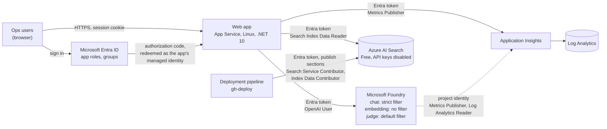
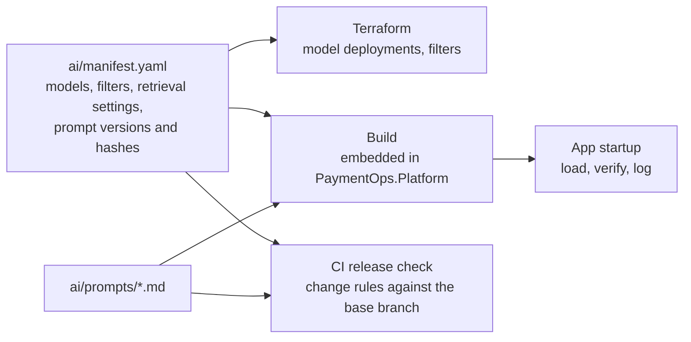
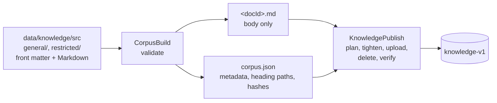
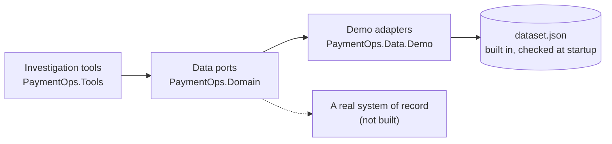
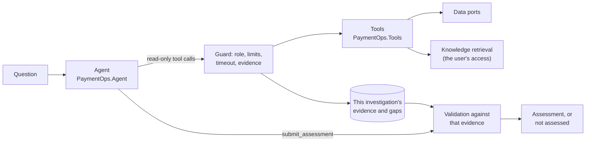
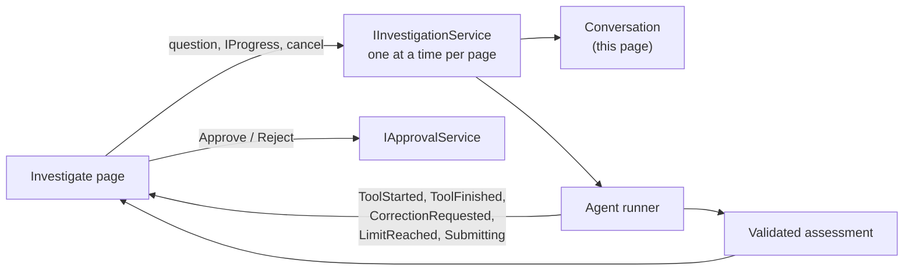
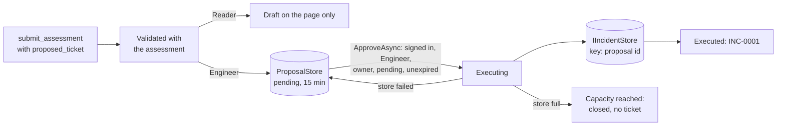
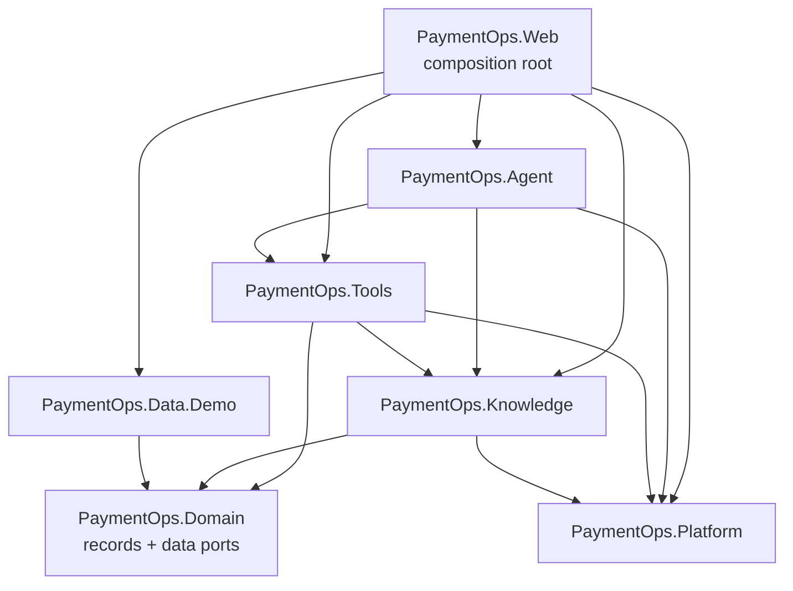

# Architecture (as built)

> In place so far: module structure, architecture tests, the web host with sign-in and telemetry, the Azure platform defined in Terraform, the knowledge corpus and its search index, the structured data behind domain ports, and the investigation agent: read-only tools over that data and the knowledge, assessments the server validates against what the tools returned, a home page that shows the investigation as it runs and carries follow-up questions, incident tickets the agent can propose and only the investigating Engineer can approve, and the evaluation suite that measures the agent against labelled cases. This document describes what has actually been implemented, and it's updated in the same pull request as the code it describes.

## Current state

| Area | Status |
|---|---|
| Solution structure | ✅ Projects and allowed dependency directions in place |
| Architecture tests | ✅ Dependency rules enforced in `PaymentOps.ArchitectureTests` |
| Web host | ✅ Blazor host with the investigation page, source pages and health endpoints |
| Infrastructure | ✅ Terraform bootstrap: state storage and keyless GitHub pipeline identities ([Deployment](Deployment.md)) |
| Azure platform | ✅ Defined in Terraform, with a model preflight. Deployed only by the deployment pipeline, after approval |
| Health endpoints | ✅ `/health` (liveness) and `/health/ready` (the app reaches Foundry and queries the knowledge index with its managed identity) |
| Sign-in and roles | ✅ Entra ID sign-in, app roles and the Risk and Compliance group; the server-side `IUserContext` and authorization policies ([Security](Security.md)) |
| Telemetry | ✅ OpenTelemetry to Application Insights, sent with the app's managed identity |
| AI release | ✅ `ai/manifest.yaml` drives the model deployments and is built into the app, which verifies it and its prompts at startup ([below](#ai-release)) |
| Knowledge corpus | ✅ Reviewed Markdown sources, validated and built into the files that are indexed ([below](#knowledge-corpus)) |
| Knowledge index | ✅ Every deployment publishes the corpus to `knowledge-v1` on a keyless Free-tier search service, one document per section, and verifies every stored field ([below](#knowledge-index)) |
| Knowledge retrieval | ✅ The server retrieves only what the user may see, for the agent's knowledge search and for source pages ([below](#knowledge-retrieval)). The grounded-answer path that answered from knowledge alone was retired when the investigation view replaced it |
| Structured data | ✅ Merchants, payments, settlement files, payouts, the settlement calendar, processor configuration and incidents, and error events behind four domain ports, served from a validated synthetic dataset built into the app ([below](#structured-data)) |
| Investigation agent | ✅ One agent with five read-only tools, limits enforced in our own code, and an assessment shown only after every statement checks out against what this investigation's tools returned ([below](#investigation-agent)) |
| Investigation view | ✅ The home page: a live timeline of tool calls written by the server, the validated assessment with each statement's support, cancel, and follow-up questions within an application-owned budget ([below](#investigation-view)) |
| Ticket approvals | ✅ The agent can propose an incident ticket; the server stores it for the Engineer who ran the investigation, and creates the ticket only when they approve, once ([below](#proposals-and-approval)) |
| Evaluation suite | ✅ `eval/PaymentOps.Evaluation` runs labelled cases through the app's own registration, observing the model, tools, knowledge and ticket store from outside; deterministic metrics over three runs, recorded judge scores and a fixed-workflow challenger ([Evaluation](Evaluation.md#release-gate)). Thresholds are frozen from a baseline of `main` ([ADR 0012](adr/0012-evaluation-thresholds-from-a-pre-registered-rule.md)). The `AI evaluation` workflow gates pull requests against them, keyless, against a dedicated evaluation index, and a weekly run of `main` records its results in Log Analytics ([Running in CI](Evaluation.md#running-in-ci)) |

## Azure platform

What runs where, and how each part authenticates. Every service-to-service call uses a managed identity; key-based authentication is disabled throughout.

*As of 2026-10-16.* The web app runs as a user-assigned identity, kept separate from the app so its role assignments survive the app being replaced. The model deployments come from `ai/manifest.yaml`, which the application also reads, so the infrastructure and the application can't disagree about which model is live. Role assignments are listed in [Security](Security.md).

## AI release

Models, content filters and prompts are configuration that changes behaviour, so they come from one reviewed file and travel inside the build ([ADR 0004](adr/0004-ai-release-manifest.md)).

- **One loader.** `AiReleaseLoader` parses the manifest strictly, reads each listed prompt, checks its `id`, `version` and body hash against the manifest, and rejects prompt files the manifest doesn't list. The app runs it before anything else is built, so a bad release stops startup. CI runs the same loader through `tools/PaymentOps.ReleaseCheck`.
- **Prompt identity.** The hash is SHA-256 over the prompt body's UTF-8 bytes with line endings converted to LF, written as `sha256:<hex>`. A changed body needs a higher version.
- **Model changes.** A deployment the release on `main` uses keeps its name, model, version, deployment type and filter; only its capacity can change. A new model or filter goes in under a new name, and switching to it and removing the old one are separate changes.
- **Access.** Code reads prompts through `IPromptProvider`. Placeholders are `{{name}}`, filled in one pass.
- **Visibility.** At startup the app logs its schema version, deployment names and each prompt's id, version and hash, never prompt text.

*As of 2026-10-22.* The manifest holds one prompt, `investigation-agent` 1.1.0, and the retrieval settings: the index, the mode and an optional semantic floor. Each further prompt is added with the feature that first uses it, and a prompt the code no longer uses is removed with that code.

## Knowledge corpus

Structured facts come from tools: payment and settlement state, processor configuration, outages, closure calendars and risk holds. The corpus holds only what explains those facts or says what to do about them: runbooks, processor operating guides, policies, escalation procedures and postmortems. A value the platform already stores, such as a cut-off or a risk threshold, is never copied into a document.

- **Sources.** Each file has front matter (`docId`, `title`, `docType`) and a Markdown body. Classification comes from the folder, `general/` or `restricted/`, never from the file. Authoring rules are in [data/knowledge](../data/knowledge/README.md).
- **Validation.** The front matter is read strictly. The body must start with one `#` heading matching the title, use `#` headings down to `###` without skipping a level, and keep every heading path unique. HTML, images, relative links, email addresses and URLs outside example domains, and numbers that pass the card checksum are rejected. Every problem is reported at once, with its file and line.
- **Output.** The build writes each body, without front matter, as `<docId>.md`, plus `corpus.json` with each document's metadata, heading paths and `contentSha256` (SHA-256 of the uploaded bytes). The front matter is build metadata, so the index never has to interpret it.
- **Identity.** A citation is a doc id plus a heading path. The doc id is permanent; a heading path is stable while the headings are. Moving a file between folders changes its classification but not its content hash, so the publisher compares every stored field, not hashes.
- **CI.** Every change builds the corpus; a shipped-corpus test also validates it.

## Knowledge index

CD builds the corpus and pushes it into the search index the AI release names in `retrieval.index` ([ADR 0005](adr/0005-indexing-by-pushing-from-the-pipeline.md)). There's no indexer, data source or search-side identity.

- **Sections.** One search document per heading that has text of its own, split with the same Markdown parse that validated it, so what's indexed is what was checked. Headings without text stay in `corpus.json` for citations. A document with no text at all fails the build.
- **Keys.** `<docId>--<SHA-256 of the heading path>`, with each heading length-prefixed, so a key is stable while its headings are and two different paths can't collide.
- **Publishing.** The publisher reads every stored document and compares every field with what the corpus produces. Sections of a document that has become restricted are deleted and confirmed gone first; then new and changed sections are uploaded; then sections no longer in the corpus are deleted. It then reads everything back and requires an exact match, retrying briefly because Search is near-real-time. When the index already matches, no section is uploaded or deleted.
- **Why tighten first.** A section that's briefly missing is safe; a restricted section that's briefly readable as general isn't.
- **Index versions.** A schema change Search can't apply in place gets a new name in `retrieval.index`.
- **Logs.** The publisher logs counts, doc ids and section paths, never section text.

| Field | Type | Behaviour | Purpose |
|---|---|---|---|
| `id` | string | key, filterable, sortable | Section key; sorting lets the read-back page through every document |
| `doc_id` | string | filterable | The document a section belongs to |
| `title` | string | searchable | Document title |
| `doc_type` | string | filterable | `runbook`, `processor-doc`, `policy` or `incident-report` |
| `classification` | string | filterable | `general` or `restricted`; every query filters on it |
| `h2`, `h3` | string | searchable | The section's headings below the title |
| `section_path` | string | retrievable | Heading path for citations |
| `ordinal` | int | sortable | The heading's position in the document |
| `content` | string | searchable, `en.microsoft` | The section's Markdown, without headings |

Every field is retrievable, so the publisher can compare it. A semantic ranking configuration ranks on `title`, `content` and the `h2`/`h3` headings, never on `doc_id` or `classification`.

## Knowledge retrieval

Knowledge is retrieved for the agent's `search_knowledge` tool and for source pages, always with the signed-in user's access ([ADR 0006](adr/0006-grounded-answers-with-a-server-owned-evidence-registry.md) for the original design).

- **Access.** `KnowledgeAccess` is built from `IUserContext`: General only, or General and Restricted for the Risk and Compliance group. The Search filter is written from it inside `PaymentOps.Knowledge`, so nothing a user or the model types reaches it.
- **Retrieval.** The top five sections the user may see, lexically or with semantic reranking. The AI release chooses the mode (`retrieval.mode`); the page and the request can't. Which mode ships is decided by measurement ([ADR 0007](adr/0007-retrieval-strategy-by-frozen-calibration.md)).
- **Sources.** `/sources/{key}` shows the exact section the agent cited, looked up with the user's access in the same query, under the same 5 s timeout as a knowledge tool call. It's rendered from an allowlist of Markdown (paragraphs, headings, lists, emphasis, code), with text encoded and links and images turned into plain text.

## Structured data

Facts a system of record holds come from data ports, never from knowledge documents ([what belongs in the corpus](../data/knowledge/README.md)). The ports are domain interfaces; this repository implements them over a curated synthetic dataset, and a real implementation would replace that with no change above the port ([ADR 0008](adr/0008-data-ports-with-demo-adapters.md)).

| Port | Answers | A real implementation would read |
|---|---|---|
| `IMerchantData` | A merchant, the processors its payments are routed to, and any risk hold with the rule that placed it | The merchant and risk systems |
| `ISettlementData` | Payments by capture time, settlement files by batch date, payouts with the files they were paid from, and the settlement calendar | The payments ledger, file intake and payout system |
| `IProcessorData` | A processor's configured cut-off, time zone, delivery times and holding period, and the incidents it reported | Processor configuration and status feeds |
| `IErrorEventData` | Our errors exchanging payments and files with processors, for a processor, a merchant or both | Platform logs or an error store |

- **One contract for every implementation.** Ranges are half-open and must not be empty; nothing found is an empty result, not an error; ids match exactly; results come in time order, then id; a caller can't change a returned list, nested ones included. There's no maximum span: a limit on what the agent may ask belongs to its tools, not to what a data source can answer. Contract tests in `PaymentOps.Data.ContractTests` state these rules, and a real implementation's tests would inherit them. A data source that can't answer throws `DataSourceUnavailableException`, whatever it is; the fault injection tests check that path.
- **The dataset.** `data/datasets/default/dataset.json` is embedded in `PaymentOps.Data.Demo`. At startup it's read strictly and checked: ids are unique and every reference resolves, no list names the same record twice, currencies are ones the dataset supports, amounts add up from payments to file lines to payouts, a payout's source files exist, were accepted and match its processor, batch and merchant, payouts are due on a settlement day and paid after their files arrived, every time is UTC, and nothing has happened after the dataset's as-of time. Any problem stops startup with all of them listed. The adapters then serve an immutable copy.
- **A fixed as-of time.** The data is a snapshot taken at Wednesday 11 November 2026, 06:00 UTC, so investigations reason about the same "yesterday" whenever they run. Sign-in and sessions use real time.
- **Fault injection.** Each port can be made slow, unresponsive, empty or unavailable, every call alike so runs repeat. Only a test host can enable it, in code; a fault setting in configuration without that stops startup.

The dataset has a slice for each investigation scenario, plus nearby records that look related but aren't ([dataset notes](../data/datasets/default/README.md)):

| Scenario | What the data shows |
|---|---|
| Payouts delayed by a processor outage | A settlement incident that covered the processor's cut-off, file transfer timeouts from that processor only, and no settlement file for the day; the other processor's file arrived |
| A missed cut-off before a closure day | A capture minutes after the cut-off, a closure day and a weekend, and a payout due later than the merchant expects but on time |
| A risk hold | Payments and files as normal, every payout held, and the rule id on the hold |
| A duplicate settlement batch | A failed acknowledgement, then the same file sent again with the same payments, and a second payout due from the resend; a split batch from the same processor looks similar but has different payments |

## Investigation agent

A question about a merchant's money is investigated by one agent that picks its own tools and arguments ([ADR 0009](adr/0009-investigation-agent-on-agent-framework.md)). It runs in the app's process on Microsoft Agent Framework, over a keyless chat client, with the signed-in user's identity. Every question starts a fresh agent session; earlier questions arrive only as plain-text context ([Conversation](#conversation)).

### Tools

| Tool | Answers |
|---|---|
| `get_merchant_profile` | The processors a merchant's payments go to, and any risk hold with the rule that placed it |
| `get_settlement_batches` | Per processor and batch date over a range: the merchant's payments, the files received, the payouts, and the facts computed from them |
| `get_processor_status` | A processor's cut-off, time zone, delivery time and holding period, and the incidents it reported in a range |
| `get_error_events` | Our errors with a processor, a merchant or both, grouped by category and code with counts |
| `search_knowledge` | Runbooks, operating guides and policies the user may read |

- **Facts, not conclusions.** Tools do the date, time-zone and set arithmetic the runbooks ask for, which is where a model is least reliable: a payment's capture time in the processor's zone against its cut-off, the batch it belongs in once closure days and weekends are skipped, whether a due file is missing, whether two files for one batch list `identical`, `disjoint` or `overlapping` payments, which days aren't settlement days, whether a payout is overdue, and how many of each error occurred. No tool returns a cause. Deciding that identical files mean a duplicate batch takes the acknowledgement failure, the resend and the runbook, and that's the agent's job. Each rule's tests quote the runbook sentence it implements.
- **Missing is claimed only against expected payments.** A file is missing when the merchant has payments expected in that batch, its delivery time plus grace has passed, and no file arrived; a file that arrived and was rejected isn't missing, as the runbook says. A data source that returns nothing produces no batches, never a false outage.
- **Typed contracts.** Each tool has its own request and response records, never Domain types (`ToolContractRulesTests`). Ids are opaque and matched exactly. Dates are `YYYY-MM-DD`, both ends included, at most 31 days and no later than today; code converts them to the ports' half-open ranges. Errors have fixed wording the model can act on, never exception text. Lists are capped with a total; on the shipped data the largest result, 31 days of settlement batches, is about 2,260 tokens.
- **Each tool works alone.** A tool checks the caller's role, validates, calls the ports with one retry on a transient failure, and returns a result with the evidence behind it. The agent adds only the limits and the investigation's evidence.

### Limits

A guard around every tool enforces these in our code; the framework's own iteration cap sits above them as a backstop.

| Limit | Value |
|---|---|
| Tool calls per investigation | 10 (submitting the assessment isn't counted) |
| Time per tool call | 5 s |
| Time per investigation | 60 s |
| The same call with the same arguments | Twice; a third stops the investigation |
| Calls with invalid arguments | Two corrections; a third stops it |

Tool calls run one at a time. An unexpected exception, or a call to a tool that doesn't exist, ends the loop at once, with no exception text sent to the model and no retry.

### Assessments

The agent finishes by calling `submit_assessment`: an outcome (`assessed`, `incomplete`, `escalated` or `refused`), a summary, claims, a root cause, a confidence, next steps and a proposed ticket or `null`. The schema sent to the model is a hint; the server parses the submission strictly whatever the deployment enforces. Every statement carries the evidence ids and citation ids that support it, and ids never appear in the text ([ADR 0010](adr/0010-validated-assessments-with-per-claim-evidence.md)).

- **The investigation's evidence.** Server code registers everything a tool returned, from typed results: knowledge sections as `S1`, `S2` and so on, records such as `payout:PO-…`, and computed facts such as `fact:missing-file:…`, each holding the exact records it was computed from. A count is supported by the group that counted every event, not by the few ids shown.
- **Validation.** The summary and every claim need at least one id, and every id must be in this investigation's evidence. Ids in the text, blank text and impossible outcomes fail too. A failure goes back to the model, listed by rule, for one correction with only `submit_assessment` available; a second failure shows nothing.
- **Set by the server, not the model.** A root cause backed by both data and knowledge is an *assessment*; otherwise it's a *hypothesis*. What the investigation couldn't check (a source unavailable or too slow, a list cut short, a check the user wasn't allowed, a limit reached) is recorded as it happens and shown in fixed words. Any such gap caps confidence at medium, and so does a hypothesis or any summary or claim that doesn't cite both data and knowledge. A stopped investigation is incomplete, with low confidence. When the data tools it tried all failed, the outcome is incomplete with no root cause, whatever was submitted.
- **Refusals.** A refusal has no claims, root cause or next steps and needs no evidence, so a question the tools can't serve is refused without a tool call. People see a fixed notice from the server instead of the model's summary; the evidence rule covers what the model states, and the notice states nothing about the data.
- **"Now" is the data's.** An investigation clock gives the dataset's as-of time, and the agent is told the date from it, so "yesterday" means the same day whenever it runs.

### Two clocks

The dataset's as-of time (11 November 2026) is later than real time, so the two must never be mixed. The investigation clock is for reasoning over the data: "yesterday", cut-offs, due files, and a proposed ticket's dates. Everything about approvals uses the host's real `TimeProvider`: when a proposal was made, its 15-minute expiry and when a ticket was created. The approval code doesn't take the investigation clock, and a test checks that.

### Investigation id

Every question gets a server-generated `InvestigationId`. It's on the result's footer, the proposal, the ticket, and the investigation and approval logs, so one investigation can be followed through all of them. It isn't a trace id, and no spans are added for it.

## Investigation view

The home page is the investigation. It talks only to `IInvestigationService` and `IApprovalService`, and the agent's text never reaches the page as markup.

- **A timeline written by the server.** The tool guard reports each call as it starts and finishes, with a label built from the parsed request: the tool's name and only the ids and dates that pass validation, never a search query or anything else the model wrote. A rejected submission, a reached limit and the submission itself are events too. The model's text isn't streamed: the answer is a tool call, and streaming it would show unvalidated text.
- **The assessment.** Each statement shows the records, computed facts (marked as computed) and knowledge sections behind it, with sections linking to their source pages. The root cause is labelled *Assessment* or *Hypothesis*, gaps are shown in their fixed words, and an incomplete or escalated outcome says so first. Model-written text is bound as text, never as Markdown or HTML.
- **Cancel.** The page owns the cancellation, so Cancel or closing the tab stops the investigation. A cancelled question is reported as cancelled, distinct from the 60 s limit, and nothing from it is kept: no turn in the conversation, no proposal.
- **Framing.** The page can approve tickets, so it's served with `frame-ancestors 'none'`.

## Conversation

Follow-up questions see earlier ones as context, never as evidence.

- **A fresh session every question.** The request is the instructions, the tool definitions, the newest earlier turns that fit, then the new question. Earlier tool calls and results are never replayed, and section ids such as `S1` never appear: a cited section is named by its title, and record ids stay as plain references the agent can look up again. Each earlier answer starts "Earlier context, not evidence for this question", and validation accepts only ids this question's own tools returned.
- **What an earlier turn carries.** The question, the outcome, the summary, the claims, the root cause with its label, the confidence, the gaps, and what became of any proposal: created with its ticket id, rejected with the reason, expired or replaced. A question that wasn't assessed, or was refused, carries one fixed line.
- **A budget the application owns.** The input budget is 32,000 tokens, a setting rather than a claim about the model. The current question reserves its share first: the instructions and tool definitions as sent (about 3,300 tokens, measured), the longest allowed question, ten tool results at 2,300 tokens each, and the output. What's left, about 3,400 tokens, goes to history, and startup refuses, with the same calculation, a budget that would leave no history. Sizes are estimated at three characters a token; the recorded live runs compared that with the counted input.
- **Ending.** A conversation ends at 20 questions, or when the newest earlier turn alone doesn't fit. When fewer than all earlier questions are carried, the page says how many the agent sees. A new investigation, or a reload, starts again with nothing carried over.

## Proposals and approval

The only action that changes anything outside the app, creating an incident ticket, is proposed by the agent and executed by the server after the owning Engineer approves ([ADR 0011](adr/0011-the-model-proposes-the-server-executes.md)).

- **The proposal.** One processor, the affected merchants, the first and last settlement dates, a title and summary, and the evidence and knowledge behind it. It's checked with the assessment: every merchant and the processor must be records this investigation returned, it needs both data evidence and a runbook citation, its dates can't be after the investigation's today and span at most 31 days, missing files from more than one processor mean a platform incident with no ticket, and the text passes the ticket content policy. A failure gets the assessment's one correction. When the investigation ends incomplete, the proposal is withheld and the page says one was proposed. That includes an outcome the server forces to incomplete (the step limit, or every data source failing): its proposal isn't checked, so it can't use the correction.
- **The processor's reference.** The tool registers each incident with its processor and reference from typed data. A ticket carries the reference when the incidents it cites for its processor agree on exactly one; model text is never searched for it.
- **Who gets a pending proposal.** Only an Engineer's (or Admin's), because only they could approve it; a Reader's stays a draft on their page, using none of the store's capacity. The next question in the conversation, or starting a new investigation, supersedes the pending one, since its card is no longer on the page. At most 500 are pending across the app; one more shows the assessment with the proposal marked unavailable.
- **Approve and reject.** Each call checks, in order, that the caller is signed in, is an Engineer now, owns the proposal (anyone else gets the same answer as a missing id), and that it's pending and unexpired. Approval moves it to executing atomically and creates the ticket with the proposal id as the idempotency key, so concurrent or repeated clicks make one ticket. If the store fails, the proposal goes back to pending; a click while another is still creating the ticket is told to try again. If the store is full, the proposal is closed as capacity reached: no ticket is created, then or on a later click, and the card says the demo ticket store has reached capacity. A rejection records one of five reasons and an optional note of up to 500 characters. There's no edit: the ticket is the approved proposal.
- **The store.** `IIncidentStore` is a domain port; the demo adapter keeps up to 1,000 tickets in memory, ids `INC-0001` onwards. Pending proposals and tickets are lost on restart, and the app runs as one instance ([ProductionGapAnalysis](ProductionGapAnalysis.md)).

## Project references

The system is a single deployable with modular boundaries. The boundaries are enforced by project references, and architecture tests check them on every build. This diagram shows the actual reference graph from the `.csproj` files.

*As of 2026-10-22.* `Web` references every module because it's the composition root, where dependency injection wires the system together. `Data.Demo` implements the data ports defined in `Domain`.

| Rule | Enforced by |
|---|---|
| `Domain` has no project references and no Azure, AI or web packages | `DependencyRulesTests` |
| `Tools` never references the demo adapters or the web host | `DependencyRulesTests` |
| Tool requests and results never expose Domain types | `ToolContractRulesTests` |
| Only the composition root (`Web`) references `Data.Demo` | `DependencyRulesTests` |
| The data ports live in `Domain`, and nothing there knows how a record is serialized | `DomainSourceRulesTests` |
| Only `Knowledge` uses the Azure AI Search SDK | `DependencyRulesTests` |
| Nothing references the web host | `DependencyRulesTests` |
| UI components use only the investigation contract (`PaymentOps.Agent.Contracts`), never Knowledge, Tools, the demo adapters, the incident store or Agent internals. A source-level check, because `Web` references every module as the composition root | `WebComponentRulesTests` |
