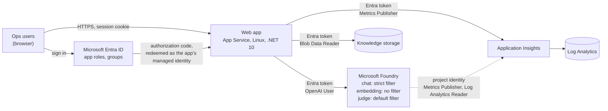
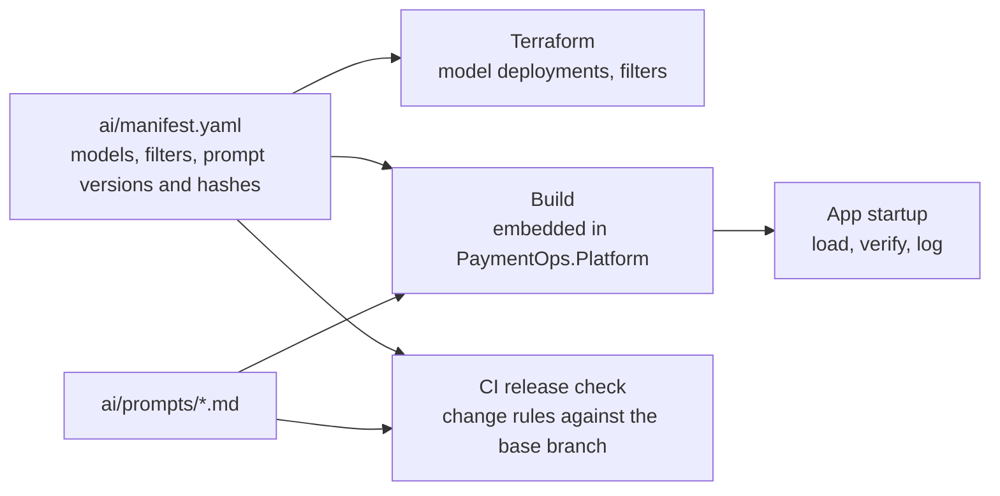
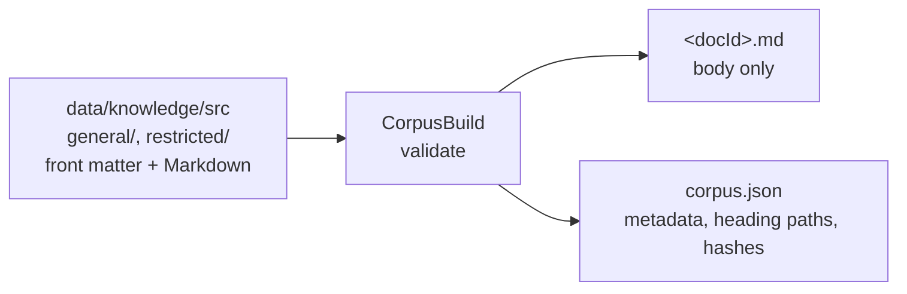
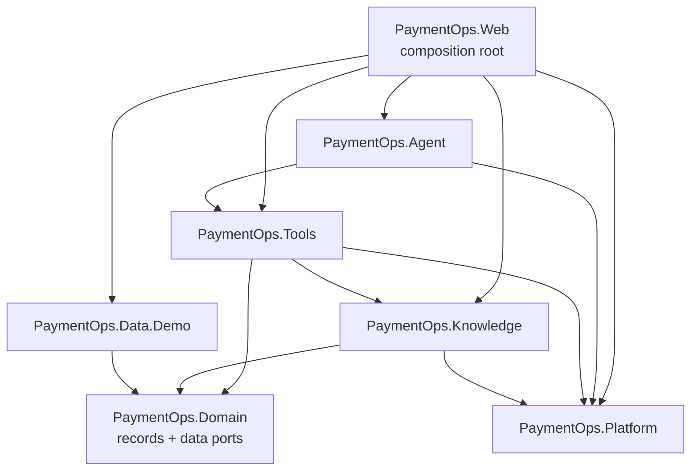

# Architecture (as built)

> Only the foundation is in place so far: module structure, architecture tests, the web host with sign-in and telemetry, and the Azure platform defined in Terraform. Product and AI capabilities come next. This document describes what has actually been implemented, and it's updated in the same pull request as the code it describes.

## Current state

| Area | Status |
|---|---|
| Solution structure | ✅ Projects and allowed dependency directions in place |
| Architecture tests | ✅ Dependency rules enforced in `PaymentOps.ArchitectureTests` |
| Web host | ✅ Placeholder Blazor host with a `/health` endpoint |
| Infrastructure | ✅ Terraform bootstrap: state storage and keyless GitHub pipeline identities ([Deployment](Deployment.md)) |
| Azure platform | ✅ Defined in Terraform, with a model preflight. Deployed only by the deployment pipeline, after approval |
| Health endpoints | ✅ `/health` (liveness) and `/health/ready` (the app reaches Foundry with its managed identity) |
| Sign-in and roles | ✅ Entra ID sign-in, app roles and the Risk and Compliance group; the server-side `IUserContext` and authorization policies ([Security](Security.md)) |
| Telemetry | ✅ OpenTelemetry to Application Insights, sent with the app's managed identity |
| AI release | ✅ `ai/manifest.yaml` drives the model deployments and is built into the app, which verifies it and its prompts at startup ([below](#ai-release)) |
| Knowledge corpus | ✅ Reviewed Markdown sources, validated and built into the files that will be indexed ([below](#knowledge-corpus)) |
| Product and AI capabilities | Not started |

## Azure platform

What runs where, and how each part authenticates. Every service-to-service call uses a managed identity; API keys and shared keys are disabled throughout.

*As of 2026-10-14.* The web app runs as a user-assigned identity, kept separate from the app so its role assignments survive the app being replaced. The model deployments come from `ai/manifest.yaml`, which the application also reads, so the infrastructure and the application can't disagree about which model is live. Role assignments are listed in [Security](Security.md).

## AI release

Models, content filters and prompts are configuration that changes behaviour, so they come from one reviewed file and travel inside the build ([ADR 0004](adr/0004-ai-release-manifest.md)).

- **One loader.** `AiReleaseLoader` parses the manifest strictly, reads each listed prompt, checks its `id`, `version` and body hash against the manifest, and rejects prompt files the manifest doesn't list. The app runs it before anything else is built, so a bad release stops startup. CI runs the same loader through `tools/PaymentOps.ReleaseCheck`.
- **Prompt identity.** The hash is SHA-256 over the prompt body's UTF-8 bytes with line endings converted to LF, written as `sha256:<hex>`. A changed body needs a higher version.
- **Model changes.** A deployment the release on `main` uses keeps its name, model, version, deployment type and filter; only its capacity can change. A new model or filter goes in under a new name, and switching to it and removing the old one are separate changes.
- **Access.** Code reads prompts through `IPromptProvider`. Placeholders are `{{name}}`, filled in one pass.
- **Visibility.** At startup the app logs its schema version, deployment names and each prompt's id, version and hash, never prompt text.

*As of 2026-10-14.* The manifest has no prompts yet: each prompt is added with the feature that first uses it, starting with grounded answers.

## Knowledge corpus

Structured facts come from tools: payment and settlement state, processor configuration, outages, closure calendars and risk holds. The corpus holds only what explains those facts or says what to do about them: runbooks, processor operating guides, policies, escalation procedures and postmortems. A value the platform already stores, such as a cut-off or a risk threshold, is never copied into a document.

- **Sources.** Each file has front matter (`docId`, `title`, `docType`) and a Markdown body. Classification comes from the folder, `general/` or `restricted/`, never from the file. Authoring rules are in [data/knowledge](../data/knowledge/README.md).
- **Validation.** The front matter is read strictly. The body must start with one `#` heading matching the title, use `#` headings down to `###` without skipping a level, and keep every heading path unique. HTML, images, relative links, email addresses and URLs outside example domains, and numbers that pass the card checksum are rejected. Every problem is reported at once, with its file and line.
- **Output.** The build writes each body, without front matter, as `<docId>.md`, plus `corpus.json` with each document's metadata, heading paths and `contentSha256` (SHA-256 of the uploaded bytes). The front matter is build metadata, so the index never has to interpret it.
- **Identity.** A citation is a doc id plus a heading path. The doc id is permanent; a heading path is stable while the headings are. Moving a file between folders changes its classification but not its content hash, so publishing compares metadata as well as content.
- **CI.** Every change builds the corpus; a shipped-corpus test also validates it.

## Project references

The system is a single deployable with modular boundaries. The boundaries are enforced by project references, and architecture tests check them on every build. This diagram shows the actual reference graph from the `.csproj` files.

*As of 2026-10-05.* `Web` references every module because it's the composition root, where dependency injection wires the system together. `Data.Demo` implements the data ports defined in `Domain`.

| Rule | Enforced by |
|---|---|
| `Domain` has no project references and no Azure, AI or web packages | `DependencyRulesTests` |
| `Tools` never references the demo adapters or the web host | `DependencyRulesTests` |
| Only the composition root (`Web`) references `Data.Demo` | `DependencyRulesTests` |
| Only `Knowledge` uses the Azure AI Search SDK | `DependencyRulesTests` |
| Nothing references the web host | `DependencyRulesTests` |
