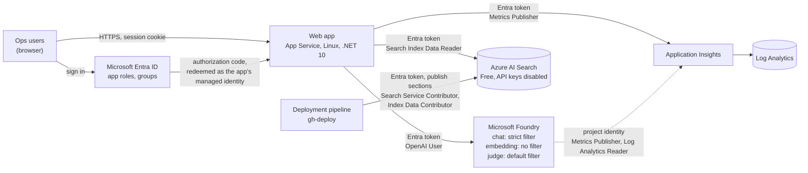
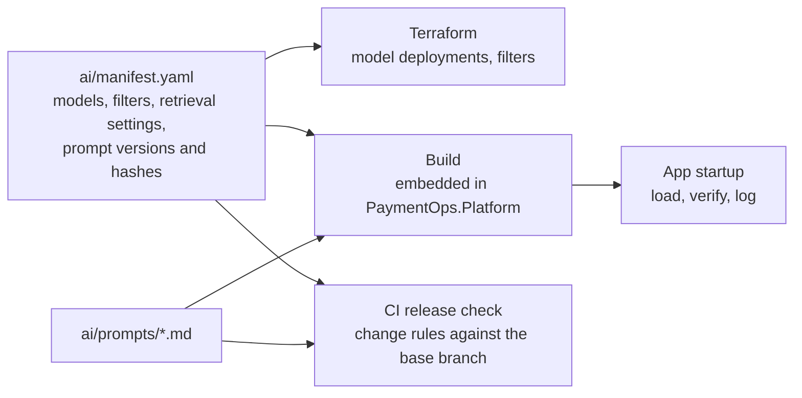
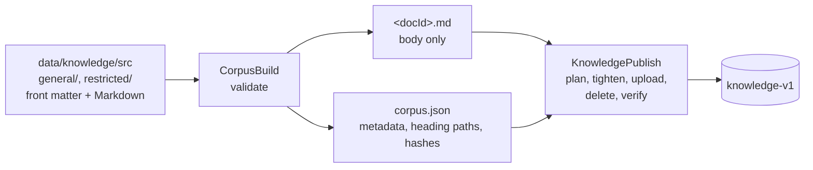
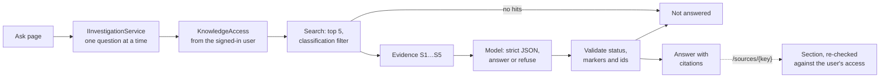
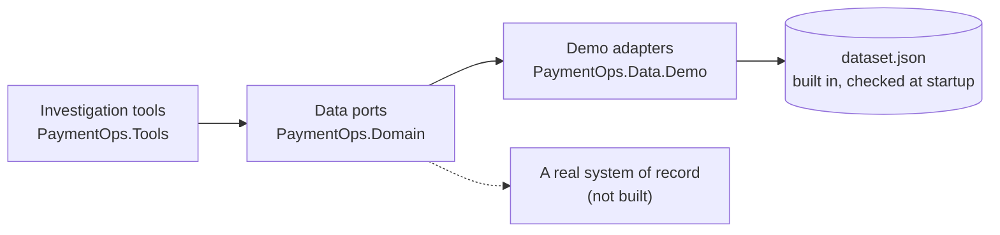
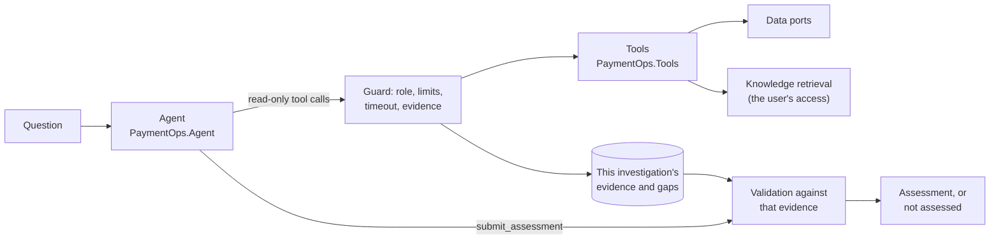
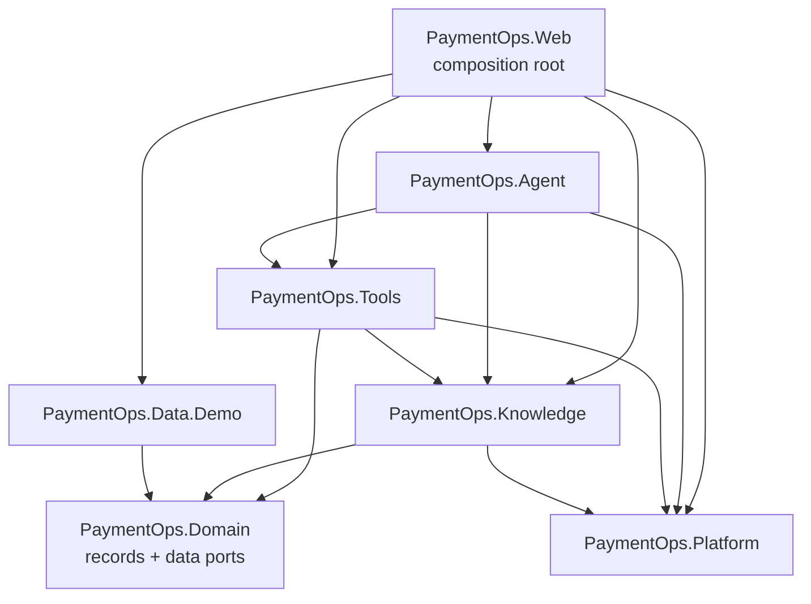

# Architecture (as built)

> In place so far: module structure, architecture tests, the web host with sign-in and telemetry, the Azure platform defined in Terraform, the knowledge corpus and its search index, grounded answers over that index with server-checked citations, the structured data behind domain ports, and the investigation agent: read-only tools over that data and the knowledge, and assessments the server validates against what the tools returned. The Ask page still answers from knowledge; the investigation view comes next. This document describes what has actually been implemented, and it's updated in the same pull request as the code it describes.

## Current state

| Area | Status |
|---|---|
| Solution structure | ✅ Projects and allowed dependency directions in place |
| Architecture tests | ✅ Dependency rules enforced in `PaymentOps.ArchitectureTests` |
| Web host | ✅ Blazor host with the Ask page, source pages and health endpoints |
| Infrastructure | ✅ Terraform bootstrap: state storage and keyless GitHub pipeline identities ([Deployment](Deployment.md)) |
| Azure platform | ✅ Defined in Terraform, with a model preflight. Deployed only by the deployment pipeline, after approval |
| Health endpoints | ✅ `/health` (liveness) and `/health/ready` (the app reaches Foundry and queries the knowledge index with its managed identity) |
| Sign-in and roles | ✅ Entra ID sign-in, app roles and the Risk and Compliance group; the server-side `IUserContext` and authorization policies ([Security](Security.md)) |
| Telemetry | ✅ OpenTelemetry to Application Insights, sent with the app's managed identity |
| AI release | ✅ `ai/manifest.yaml` drives the model deployments and is built into the app, which verifies it and its prompts at startup ([below](#ai-release)) |
| Knowledge corpus | ✅ Reviewed Markdown sources, validated and built into the files that are indexed ([below](#knowledge-corpus)) |
| Knowledge index | ✅ Every deployment publishes the corpus to `knowledge-v1` on a keyless Free-tier search service, one document per section, and verifies every stored field ([below](#knowledge-index)) |
| Retrieval and answers | ✅ One question, one answer: the server retrieves only what the user may see, the model answers from that evidence or refuses, and every citation is checked before it's shown ([below](#retrieval-and-answers)) |
| Structured data | ✅ Merchants, payments, settlement files, payouts, the settlement calendar, processor configuration and incidents, and error events behind four domain ports, served from a validated synthetic dataset built into the app ([below](#structured-data)) |
| Investigation agent | ✅ One agent with five read-only tools, limits enforced in our own code, and an assessment shown only after every statement checks out against what this investigation's tools returned. Reached through the investigation service; not yet on a page ([below](#investigation-agent)) |

## Azure platform

What runs where, and how each part authenticates. Every service-to-service call uses a managed identity; key-based authentication is disabled throughout.

*As of 2026-10-16.* The web app runs as a user-assigned identity, kept separate from the app so its role assignments survive the app being replaced. The model deployments come from `ai/manifest.yaml`, which the application also reads, so the infrastructure and the application can't disagree about which model is live. Role assignments are listed in [Security](Security.md).

## AI release

Models, content filters and prompts are configuration that changes behaviour, so they come from one reviewed file and travel inside the build ([ADR 0004](adr/0004-ai-release-manifest.md)).

- **One loader.** `AiReleaseLoader` parses the manifest strictly, reads each listed prompt, checks its `id`, `version` and body hash against the manifest, and rejects prompt files the manifest doesn't list. The app runs it before anything else is built, so a bad release stops startup. CI runs the same loader through `tools/PaymentOps.ReleaseCheck`.
- **Prompt identity.** The hash is SHA-256 over the prompt body's UTF-8 bytes with line endings converted to LF, written as `sha256:<hex>`. A changed body needs a higher version.
- **Model changes.** A deployment the release on `main` uses keeps its name, model, version, deployment type and filter; only its capacity can change. A new model or filter goes in under a new name, and switching to it and removing the old one are separate changes.
- **Access.** Code reads prompts through `IPromptProvider`. Placeholders are `{{name}}`, filled in one pass.
- **Visibility.** At startup the app logs its schema version, deployment names and each prompt's id, version and hash, never prompt text.

*As of 2026-10-19.* The manifest holds one prompt, `grounded-answer`, and the retrieval settings: the index, the mode and an optional semantic floor. Each further prompt is added with the feature that first uses it.

## Knowledge corpus

Structured facts come from tools: payment and settlement state, processor configuration, outages, closure calendars and risk holds. The corpus holds only what explains those facts or says what to do about them: runbooks, processor operating guides, policies, escalation procedures and postmortems. A value the platform already stores, such as a cut-off or a risk threshold, is never copied into a document.

- **Sources.** Each file has front matter (`docId`, `title`, `docType`) and a Markdown body. Classification comes from the folder, `general/` or `restricted/`, never from the file. Authoring rules are in [data/knowledge](../data/knowledge/README.md).
- **Validation.** The front matter is read strictly. The body must start with one `#` heading matching the title, use `#` headings down to `###` without skipping a level, and keep every heading path unique. HTML, images, relative links, email addresses and URLs outside example domains, and numbers that pass the card checksum are rejected. Every problem is reported at once, with its file and line.
- **Output.** The build writes each body, without front matter, as `<docId>.md`, plus `corpus.json` with each document's metadata, heading paths and `contentSha256` (SHA-256 of the uploaded bytes). The front matter is build metadata, so the index never has to interpret it.
- **Identity.** A citation is a doc id plus a heading path. The doc id is permanent; a heading path is stable while the headings are. Moving a file between folders changes its classification but not its content hash, so the publisher compares every stored field, not hashes.
- **CI.** Every change builds the corpus; a shipped-corpus test also validates it.

## Knowledge index

CD builds the corpus and pushes it into the search index the AI release names in `retrieval.index` ([ADR 0005](adr/0005-indexing-by-pushing-from-the-pipeline.md)). There's no indexer, data source or search-side identity.

- **Sections.** One search document per heading that has text of its own, split with the same Markdown parse that validated it, so what's indexed is what was checked. Headings without text stay in `corpus.json` for citations. A document with no text at all fails the build.
- **Keys.** `<docId>--<SHA-256 of the heading path>`, with each heading length-prefixed, so a key is stable while its headings are and two different paths can't collide.
- **Publishing.** The publisher reads every stored document and compares every field with what the corpus produces. Sections of a document that has become restricted are deleted and confirmed gone first; then new and changed sections are uploaded; then sections no longer in the corpus are deleted. It then reads everything back and requires an exact match, retrying briefly because Search is near-real-time. When the index already matches, no section is uploaded or deleted.
- **Why tighten first.** A section that's briefly missing is safe; a restricted section that's briefly readable as general isn't.
- **Index versions.** A schema change Search can't apply in place gets a new name in `retrieval.index`.
- **Logs.** The publisher logs counts, doc ids and section paths, never section text.

| Field | Type | Behaviour | Purpose |
|---|---|---|---|
| `id` | string | key, filterable, sortable | Section key; sorting lets the read-back page through every document |
| `doc_id` | string | filterable | The document a section belongs to |
| `title` | string | searchable | Document title |
| `doc_type` | string | filterable | `runbook`, `processor-doc`, `policy` or `incident-report` |
| `classification` | string | filterable | `general` or `restricted`; every query filters on it |
| `h2`, `h3` | string | searchable | The section's headings below the title |
| `section_path` | string | retrievable | Heading path for citations |
| `ordinal` | int | sortable | The heading's position in the document |
| `content` | string | searchable, `en.microsoft` | The section's Markdown, without headings |

Every field is retrievable, so the publisher can compare it. A semantic ranking configuration ranks on `title`, `content` and the `h2`/`h3` headings, never on `doc_id` or `classification`.

## Retrieval and answers

A signed-in user asks one question on the home page. The page talks only to `IInvestigationService`; retrieval mode, prompts and models stay behind it ([ADR 0006](adr/0006-grounded-answers-with-a-server-owned-evidence-registry.md)).

- **Access.** `KnowledgeAccess` is built from `IUserContext`: General only, or General and Restricted for the Risk and Compliance group. The Search filter is written from it inside `PaymentOps.Knowledge`, so nothing a user types reaches it.
- **Retrieval.** The top five sections the user may see, lexically or with semantic reranking. The AI release chooses the mode (`retrieval.mode`); the page and the request can't. Which mode ships is decided by measurement ([ADR 0007](adr/0007-retrieval-strategy-by-frozen-calibration.md)).
- **Evidence.** Each retrieved section gets an id for this question only, `S1` to `S5`. Section keys belong to the corpus; these ids belong to one model call and its validation.
- **Answer.** The model returns a strict JSON object: an answer with `[Sn]` markers and the ids it cited, or a refusal. The server checks the status rules, that the markers and the cited ids are exactly the same set, and that every id was retrieved for this question. Any failure turns the whole answer into a fixed message; a bad citation is never dropped to show the rest.
- **Not answered.** No hits, an unreachable service, a filtered or incomplete response and an answer that fails validation each have their own reason, for diagnosis. The page shows a fixed message for each, never model or provider text.
- **Rendering.** Answers and sections are rendered from an allowlist of Markdown (paragraphs, headings, lists, emphasis, code). Text is encoded, links and images become plain text, and the only links are citations the server builds from validated ids.
- **Sources.** `/sources/{key}` shows the exact section the model saw, looked up with the user's access in the same query.

| Not answered because | Model called |
|---|---|
| Blank or overlong question, not signed in, another question running on the same page | No |
| Search failed or timed out; no section the user may see matched | No |
| The model call failed, timed out, was filtered or cut short, or the answer failed validation | Yes |
| The model found the evidence insufficient and refused | Yes |

## Structured data

Facts a system of record holds come from data ports, never from knowledge documents ([what belongs in the corpus](../data/knowledge/README.md)). The ports are domain interfaces; this repository implements them over a curated synthetic dataset, and a real implementation would replace that with no change above the port ([ADR 0008](adr/0008-data-ports-with-demo-adapters.md)).

| Port | Answers | A real implementation would read |
|---|---|---|
| `IMerchantData` | A merchant, the processors its payments are routed to, and any risk hold with the rule that placed it | The merchant and risk systems |
| `ISettlementData` | Payments by capture time, settlement files by batch date, payouts with the files they were paid from, and the settlement calendar | The payments ledger, file intake and payout system |
| `IProcessorData` | A processor's configured cut-off, time zone, delivery times and holding period, and the incidents it reported | Processor configuration and status feeds |
| `IErrorEventData` | Our errors exchanging payments and files with processors, for a processor, a merchant or both | Platform logs or an error store |

- **One contract for every implementation.** Ranges are half-open and must not be empty; nothing found is an empty result, not an error; ids match exactly; results come in time order, then id; a caller can't change a returned list, nested ones included. There's no maximum span: a limit on what the agent may ask belongs to its tools, not to what a data source can answer. Contract tests in `PaymentOps.Data.ContractTests` state these rules, and a real implementation's tests would inherit them. A data source that can't answer throws `DataSourceUnavailableException`, whatever it is; the fault injection tests check that path.
- **The dataset.** `data/datasets/default/dataset.json` is embedded in `PaymentOps.Data.Demo`. At startup it's read strictly and checked: ids are unique and every reference resolves, no list names the same record twice, currencies are ones the dataset supports, amounts add up from payments to file lines to payouts, a payout's source files exist, were accepted and match its processor, batch and merchant, payouts are due on a settlement day and paid after their files arrived, every time is UTC, and nothing has happened after the dataset's as-of time. Any problem stops startup with all of them listed. The adapters then serve an immutable copy.
- **A fixed as-of time.** The data is a snapshot taken at Wednesday 11 November 2026, 06:00 UTC, so investigations reason about the same "yesterday" whenever they run. Sign-in and sessions use real time.
- **Fault injection.** Each port can be made slow, unresponsive, empty or unavailable, every call alike so runs repeat. Only a test host can enable it, in code; a fault setting in configuration without that stops startup.

The dataset has a slice for each investigation scenario, plus nearby records that look related but aren't ([dataset notes](../data/datasets/default/README.md)):

| Scenario | What the data shows |
|---|---|
| Payouts delayed by a processor outage | A settlement incident that covered the processor's cut-off, file transfer timeouts from that processor only, and no settlement file for the day; the other processor's file arrived |
| A missed cut-off before a closure day | A capture minutes after the cut-off, a closure day and a weekend, and a payout due later than the merchant expects but on time |
| A risk hold | Payments and files as normal, every payout held, and the rule id on the hold |
| A duplicate settlement batch | A failed acknowledgement, then the same file sent again with the same payments, and a second payout due from the resend; a split batch from the same processor looks similar but has different payments |

## Investigation agent

A question about a merchant's money is investigated by one agent that picks its own tools and arguments ([ADR 0009](adr/0009-investigation-agent-on-agent-framework.md)). It runs in the app's process on Microsoft Agent Framework, over the same keyless chat client as grounded answers, with the signed-in user's identity. Each investigation is one question; nothing from an earlier one is carried in.

### Tools

| Tool | Answers |
|---|---|
| `get_merchant_profile` | The processors a merchant's payments go to, and any risk hold with the rule that placed it |
| `get_settlement_batches` | Per processor and batch date over a range: the merchant's payments, the files received, the payouts, and the facts computed from them |
| `get_processor_status` | A processor's cut-off, time zone, delivery time and holding period, and the incidents it reported in a range |
| `get_error_events` | Our errors with a processor, a merchant or both, grouped by category and code with counts |
| `search_knowledge` | Runbooks, operating guides and policies the user may read |

- **Facts, not conclusions.** Tools do the date, time-zone and set arithmetic the runbooks ask for, which is where a model is least reliable: a payment's capture time in the processor's zone against its cut-off, the batch it belongs in once closure days and weekends are skipped, whether a due file is missing, whether two files for one batch list `identical`, `disjoint` or `overlapping` payments, which days aren't settlement days, whether a payout is overdue, and how many of each error occurred. No tool returns a cause. Deciding that identical files mean a duplicate batch takes the acknowledgement failure, the resend and the runbook, and that's the agent's job. Each rule's tests quote the runbook sentence it implements.
- **Missing is claimed only against expected payments.** A file is missing when the merchant has payments expected in that batch, its delivery time plus grace has passed, and no file arrived; a file that arrived and was rejected isn't missing, as the runbook says. A data source that returns nothing produces no batches, never a false outage.
- **Typed contracts.** Each tool has its own request and response records, never Domain types (`ToolContractRulesTests`). Ids are opaque and matched exactly. Dates are `YYYY-MM-DD`, both ends included, at most 31 days and no later than today; code converts them to the ports' half-open ranges. Errors have fixed wording the model can act on, never exception text. Lists are capped with a total, so a result stays near 2,000 tokens.
- **Each tool works alone.** A tool checks the caller's role, validates, calls the ports with one retry on a transient failure, and returns a result with the evidence behind it. The agent adds only the limits and the investigation's evidence.

### Limits

A guard around every tool enforces these in our code; the framework's own iteration cap sits above them as a backstop.

| Limit | Value |
|---|---|
| Tool calls per investigation | 10 (submitting the assessment isn't counted) |
| Time per tool call | 5 s |
| Time per investigation | 60 s |
| The same call with the same arguments | Twice; a third stops the investigation |
| Calls with invalid arguments | Two corrections; a third stops it |

Tool calls run one at a time. An unexpected exception, or a call to a tool that doesn't exist, ends the loop at once, with no exception text sent to the model and no retry.

### Assessments

The agent finishes by calling `submit_assessment` with a strict schema: an outcome (`assessed`, `incomplete`, `escalated` or `refused`), a summary, claims, a root cause, a confidence and next steps. Every statement carries the evidence ids and citation ids that support it, and ids never appear in the text ([ADR 0010](adr/0010-validated-assessments-with-per-claim-evidence.md)).

- **The investigation's evidence.** Server code registers everything a tool returned, from typed results: knowledge sections as `S1`, `S2` and so on, records such as `payout:PO-…`, and computed facts such as `fact:missing-file:…`, each holding the exact records it was computed from. A count is supported by the group that counted every event, not by the few ids shown.
- **Validation.** The summary and every claim need at least one id, and every id must be in this investigation's evidence. Ids in the text, blank text and impossible outcomes fail too. A failure goes back to the model, listed by rule, for one correction with only `submit_assessment` available; a second failure shows nothing.
- **Set by the server, not the model.** A root cause backed by both data and knowledge is an *assessment*; otherwise it's a *hypothesis*. What the investigation couldn't check (a source unavailable or too slow, a list cut short, a check the user wasn't allowed, a limit reached) is recorded as it happens and shown in fixed words. Any such gap caps confidence at medium. A stopped investigation is incomplete, with low confidence. When the data tools it tried all failed, the outcome is incomplete with no root cause, whatever was submitted.
- **"Now" is the data's.** An investigation clock gives the dataset's as-of time, and the agent is told the date from it, so "yesterday" means the same day whenever it runs. The rest of the app keeps real time.

## Project references

The system is a single deployable with modular boundaries. The boundaries are enforced by project references, and architecture tests check them on every build. This diagram shows the actual reference graph from the `.csproj` files.

*As of 2026-10-21.* `Web` references every module because it's the composition root, where dependency injection wires the system together. `Data.Demo` implements the data ports defined in `Domain`.

| Rule | Enforced by |
|---|---|
| `Domain` has no project references and no Azure, AI or web packages | `DependencyRulesTests` |
| `Tools` never references the demo adapters or the web host | `DependencyRulesTests` |
| Tool requests and results never expose Domain types | `ToolContractRulesTests` |
| Only the composition root (`Web`) references `Data.Demo` | `DependencyRulesTests` |
| The data ports live in `Domain`, and nothing there knows how a record is serialized | `DomainSourceRulesTests` |
| Only `Knowledge` uses the Azure AI Search SDK | `DependencyRulesTests` |
| Nothing references the web host | `DependencyRulesTests` |
| UI components use only the investigation contract (`PaymentOps.Agent.Contracts`), never Knowledge, Tools, the demo adapters or Agent internals. A source-level check, because `Web` references every module as the composition root | `WebComponentRulesTests` |
